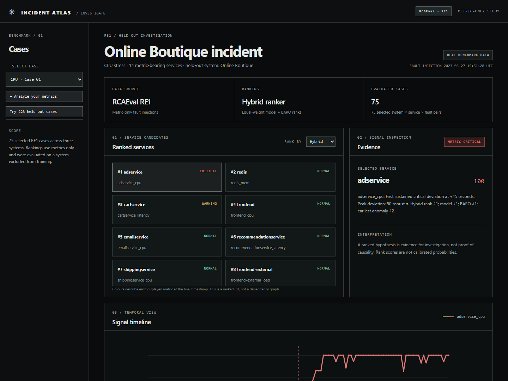
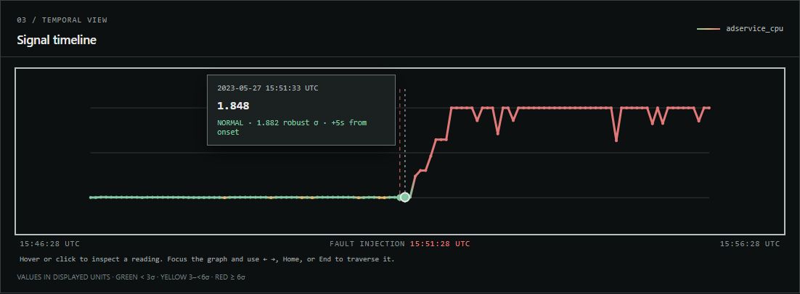
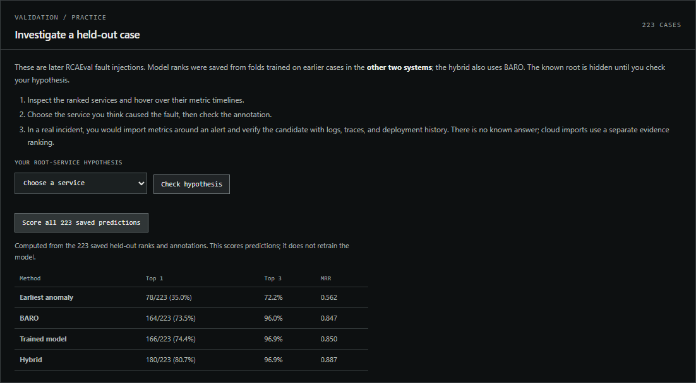
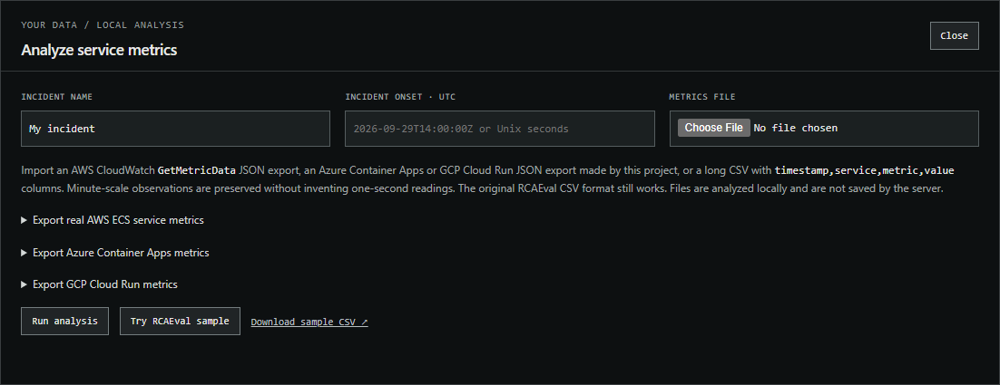

# Incident Atlas

Incident Atlas is a local service-metrics investigation app. Its cloud exporters read Amazon ECS, Azure Container Apps, or GCP Cloud Run metrics using configured provider credentials. The app imports timestamped observations without inventing one-second samples, ranks changes around a known incident onset, and exports a Markdown evidence report. It also accepts long-form CSV from other monitoring systems. A separate [RCAEval](https://github.com/phamquiluan/RCAEval) benchmark explorer retains the trained model, BARO comparison, and held-out evaluation.

The built-in benchmark uses **real benchmark telemetry**. RCAEval cases are controlled fault injections, not production outages. A high rank from either path is a hypothesis, not proof of cause.



## How to run

Install **Python 3.11**, **Node.js 18 or newer**, and **Git**. Clone the repository:

```sh
git clone https://github.com/aryagith/incident-atlas.git
cd incident-atlas
```

### Windows (PowerShell)

```powershell
python -m venv .venv
.\.venv\Scripts\python.exe -m pip install -r requirements.txt
node server.mjs
```

### macOS / Linux

```sh
python3.11 -m venv .venv
.venv/bin/python -m pip install -r requirements.txt
node server.mjs
```

Open [http://localhost:8000](http://localhost:8000). The server binds to `127.0.0.1`; set `PORT` to use another local port. The benchmark bundles and deployable [model/ranker.joblib](model/ranker.joblib) are included. No dataset download or API key is needed to use the benchmark. The browser sends imports to the local Python analyzer; the server does not save uploaded files. Imported incidents remain in the browser session and disappear on reload.

To stop the server, press **Ctrl+C** in its terminal. To run the automated checks, use `.\.venv\Scripts\python.exe -m unittest discover -v` on Windows or `.venv/bin/python -m unittest discover -v` on macOS/Linux.

## Explore the dashboard

1. Choose an incident from **Select case**. Switch **Rank by** between Hybrid, Model, and BARO to compare their service rankings.
2. Click a service card to inspect its metric. Hover or click the timeline to read a sample, or focus the graph and use the arrow keys, Home, and End. Green, yellow, and red show increasing statistical deviation from the normal window.
3. Use **Reveal ground truth** to compare your hypothesis with the injected fault, and **Export report** to save an evidence summary.



### Practice on held-out cases

Click **Try 223 held-out cases**, inspect a case, choose your root-service hypothesis, and click **Check hypothesis**. **Score all 223 saved predictions** reproduces the saved validation scores in the browser; it does not train a model or run a new evaluation on your own data.



### Analyze your own metrics

Click **Analyze your metrics**, enter an incident name and onset, select a CSV or supported provider JSON file, and click **Run analysis**. If you do not have cloud services running, **Try RCAEval sample** exercises the local analyzer with the included benchmark sample. The provider-specific export instructions below explain how to obtain metrics from actual services.



## Use real AWS ECS metrics

Install and configure the [AWS CLI](https://docs.aws.amazon.com/cli/latest/userguide/getting-started-install.html) with a profile allowed to call [`cloudwatch:GetMetricData`](https://docs.aws.amazon.com/AmazonCloudWatch/latest/monitoring/permissions-reference-cw.html). Choose the ECS cluster, at least two service names, AWS region, and known incident onset from an alert or deployment record. From this project directory, run:

```powershell
.\.venv\Scripts\python.exe aws_ecs_export.py --cluster production --services checkout payments --onset 2026-09-29T14:00:00Z --region us-east-1
```

Use `--profile NAME` for a non-default configured AWS profile and `--output PATH` to change the default `cloudwatch-export.json` filename. The exporter requests each service's CPU and memory utilization at 60-second resolution over 30 minutes before and after onset. These [ECS metrics and dimensions](https://docs.aws.amazon.com/AmazonECS/latest/developerguide/available-metrics.html) and their [default cadence](https://docs.aws.amazon.com/AmazonECS/latest/developerguide/service_utilization.html) are documented by AWS; the exporter uses CloudWatch's [GetMetricData output](https://docs.aws.amazon.com/cli/latest/reference/cloudwatch/get-metric-data.html). It uses your existing AWS CLI credentials locally and writes metric values to the specified JSON file. The default filename is Git-ignored.

In the app, click **Analyze your metrics**, enter the same onset and an incident name, and select the JSON file. The result ranks observed changes at their actual timestamps. Missing service readings after onset are shown as a missing signal if another service continues reporting; verify whether tasks stopped or telemetry was interrupted. The export may lack metrics for services without running tasks, as [AWS documents](https://docs.aws.amazon.com/AmazonECS/latest/developerguide/available-metrics.html). A service needs 10 pre-onset observations; at least one service needs 5 post-onset observations. Use **Export report** to save the evidence summary.

This cloud ranking is a transparent triage heuristic: it prioritizes missing telemetry, then the earliest two consecutive critical deviations, affected metric count, and peak deviation. It has **no measured root-cause accuracy on AWS incidents**. The RCAEval model and BARO scores are deliberately absent from cloud imports because they were developed on a different one-second dataset. A changed downstream service may outrank the actual cause.

## Use real Azure Container Apps metrics

Sign in with the [Azure CLI](https://learn.microsoft.com/cli/azure/authenticate-azure-cli) to a subscription where you can read Azure Monitor metrics. Choose at least two Container Apps in one resource group and the incident onset. Run:

```powershell
.\.venv\Scripts\python.exe provider_export.py azure --subscription 11111111-1111-1111-1111-111111111111 --resource-group production --services checkout payments --onset 2026-09-29T14:00:00Z
```

Replace the example subscription UUID and names. Import the resulting `azure-containerapps-export.json` in the app with the same onset. The exporter calls the [Azure Monitor Metrics REST API](https://learn.microsoft.com/en-us/rest/api/monitor/metrics/list?view=rest-monitor-2023-10-01) through the signed-in Azure CLI. For each app it requests the documented [Container Apps metrics](https://learn.microsoft.com/en-us/azure/container-apps/metrics) `UsageNanoCores`, `WorkingSetBytes`, and `Requests` at `PT1M`. CPU and memory use the rolled-up **Average**; requests use **Total** per minute. Units stay as nanocores, bytes, and count per minute. Null buckets remain gaps. A response split into multiple dimension series is rejected rather than silently combined. Use `--output PATH` to pick another output file.

## Use real GCP Cloud Run metrics

Sign in with the [Google Cloud CLI](https://docs.cloud.google.com/sdk/docs/authorizing) to a project where you can read Cloud Monitoring time series. Choose at least two Cloud Run services in the same region and the incident onset. Run:

```powershell
.\.venv\Scripts\python.exe provider_export.py gcp --project YOUR_PROJECT --region us-central1 --services checkout payments --onset 2026-09-29T14:00:00Z
```

Import `gcp-cloudrun-export.json` with the same onset. The exporter uses the CLI's short-lived access token only in memory to call [`projects.timeSeries.list`](https://docs.cloud.google.com/monitoring/api/ref_v3/rest/v3/projects.timeSeries/list), follows page tokens, and requests only the named Cloud Run services. It maps the documented [Cloud Run metrics](https://docs.cloud.google.com/monitoring/api/metrics_gcp_p_z): CPU and memory utilization distributions become a one-minute **median per revision, then mean across revisions**; request counts become a one-minute sum across revisions and response codes. Google's utilization ratio is multiplied by 100 for display as percent, per its [unit definition](https://docs.cloud.google.com/monitoring/api/ref_v3/rpc/google.api). These are service summaries, not per-container diagnostics. Cloud Run may have no samples when scaled to zero or idle; those gaps remain gaps. Use `--output PATH` for another filename.

Both exporters validate that the output has at least two usable services before saving. Their default filenames are Git-ignored. They read metrics with existing CLI sign-in and do not save credentials. Azure and GCP imports use the same unvalidated evidence ranking as AWS; the RCAEval model and benchmark accuracy do not apply.

## Import a long-form CSV

If another monitor can export metric values, provide UTF-8 CSV with this header and timestamped rows. ISO 8601 timestamps must include a timezone; Unix seconds also work. An optional `unit` column is supported.

```csv
timestamp,service,metric,value,unit
2026-09-29T13:30:00Z,checkout,cpu,41.3,%
2026-09-29T13:30:00Z,payments,cpu,28.1,%
2026-09-29T13:31:00Z,checkout,cpu,42.0,%
2026-09-29T13:31:00Z,payments,cpu,27.9,%
```

Supply two or more services, 2–200 metric series, 10 pre-onset observations per usable series, and at least one series with 5 post-onset observations inside the 30-minute window on each side. Readings need not align perfectly or arrive every second; gaps stay gaps. Duplicate points and nonfinite values are rejected. This is a portable schema; Azure and GCP **console CSV downloads** might have different columns. Use the provider exporters above for their documented API responses.

## RCAEval CSV and benchmark model

**Try RCAEval sample** runs the included [web/example.csv](web/example.csv), a real 601-second slice of `re1ob_adservice_cpu_1` with onset `1685202688`. Its known answer is used only to check the sample, never sent with the import. The original one-second wide CSV format remains supported:

```csv
time,frontend_cpu,frontend_latency,cartservice_cpu,cartservice_latency
1685202388,12.4,28.0,8.1,17.2
1685202389,12.2,27.8,8.0,17.1
```

Use 2–200 unique `service_metric` columns, 601–3,601 consecutive one-second rows, and at least 300 seconds before and after onset. Service and metric names may contain letters, numbers, and hyphens; a single underscore separates them. Values must be finite numbers or blank. Each usable metric needs at least 60 finite pre-onset readings; at least two services need usable metrics. For all imports, the input limit is 5 MB and analysis has a 30-second server timeout. The endpoint is `POST /api/analyze` with JSON `{ "name": "...", "onset": "2026-09-29T14:00:00Z", "content": "...file text..." }`.

The deployable Extra Trees model was retrained on all **373 valid RE1 cases** and is used only for this benchmark-shaped CSV path. The benchmark's held-out fold scores refer to different fold models, so they do **not** estimate accuracy on an arbitrary imported incident. Imports have no ground-truth label; candidates are hypotheses rather than verified causes. Green/yellow/red show statistical deviation, not confirmed health, overload, or crashes.

## Reproduce the benchmark

Run `.\.venv\Scripts\python.exe benchmark.py all` to fetch the pinned RCAEval revision, regenerate [web/benchmark.json](web/benchmark.json), [web/sensitivity.json](web/sensitivity.json), [web/validation.json](web/validation.json), and [web/validation-cases.json](web/validation-cases.json), and retrain the deployable model. `build`, `sensitivity`, `validation`, and `train` can be run separately. The three benchmark folds train on the first selected cases from the *other two systems*; the deployable model trains on all valid RE1 cases. Raw Parquet stays in ignored `data/`. Run `.\.venv\Scripts\python.exe probe_ranker.py` to reproduce the nine-classifier development comparison; it does not change the benchmark bundles.

The benchmark case picker covers Online Boutique, Sock Shop, and Train Ticket. Select a case and service to inspect its recorded metric and statistical deviation around the injected fault. The benchmark ranks and evaluation tables are saved outputs from the Python run; imported ranks are computed by the local API. Reveal benchmark ground truth separately; the underlying dataset case names encode the answer, so this is a presentation aid rather than a blind challenge.

Hover or click the timeline to inspect a displayed observation; focus it and use the arrow, Home, and End keys to traverse samples. Cloud service cards rank using all imported metric streams, and the metric selector lets you inspect each stream without changing the service rank. The chart shows at most 121 samples per stream, while cloud ranking uses all observations in the import.

Click **Try 223 held-out cases** to load the validation case detail bundle on demand. Choose a service as your hypothesis, inspect the saved metric timelines and ranks, then check it against the annotated root. **Score all 223 saved predictions** recomputes top-1, top-3, and MRR from those case outcomes in the browser; it does not retrain a model. These are saved predictions from leave-one-system-out fold models, not predictions from the deployable model trained on all 373 cases. The case IDs encode the answer in the source data, so this is a learning exercise rather than a blind test. A real cloud incident has no answer to reveal and uses the separate cloud evidence ranking.

## Data and provenance

- **Source:** [RCAEval dataset mirror](https://huggingface.co/datasets/phamquiluan/RCAEval), revision `afeacb11bcc94dadfd1c8f483ee4377b2b8b614e`; [authors' code](https://github.com/phamquiluan/RCAEval).
- **License:** MIT for the dataset and authors' code, per the dataset card and repository. BARO is MIT licensed in RCAEval's third-party license list.
- **Selection:** the first two valid repetitions of each 5 injected services × 5 faults × 3 systems pair form the 150-case development set. The next two valid repetitions and the remaining valid repetition form the 223-case validation set. Case IDs, ranks, cohort IDs, and settings are in the three included JSON bundles. The validation model trains only on the first cohort from the other two systems.
- **Exclusions:** `re1ob_currencyservice_loss_1` has a malformed injection timestamp (`16933142`) before its recorded time range; repetition 2 takes its primary slot. `re1ob_productcatalogservice_cpu_3` also has an injection timestamp beyond its recorded end. These two pairs therefore have only four valid repetitions, leaving 73 rather than 75 cases in the last cohort.
- **Telemetry:** the original Parquet values are displayed without unit conversion. The dataset's wide metric table does not provide a per-column unit field; the UI therefore shows source metric names and leaves units unspecified. Null readings remain gaps in the chart.
- **Included sample:** [web/example.csv](web/example.csv) is derived from the RCAEval case `re1ob_adservice_cpu_1` at the pinned revision under that dataset's MIT license.

## Benchmark methods

All methods receive the fault injection time and the same 300 seconds before and after it. This is a *localization* task with a known onset, not onset detection. For each metric, Incident Atlas computes a normal-window median and robust deviation scale:

```text
scale = max(1.4826 × MAD, 0.1 × standard deviation,
            0.01 × |median|, 0.000001)
deviation = min(|value − median| / scale, 50)
```

The **earliest-anomaly baseline** finds the first post-injection run of five consecutive seconds at deviation ≥6 for each metric, then ranks each service by its earliest metric. Ties favor more triggered metrics, then a larger peak deviation. No trigger receives a 301-second sentinel. The chart's green/yellow/red line uses deviation below 3, from 3 to below 6, and at least 6 respectively. These are statistical thresholds, not verified overload or crash thresholds.

The **trained ranker** aggregates seven case-local service features: first anomaly time, peak and top-three peak deviation, triggered metric count and fraction, maximum persistence, and metric count. It uses scikit-learn `ExtraTreesClassifier` with 100 trees, depth 5, minimum leaf size 3, balanced classes, and seed 7. It trains on two complete systems and predicts the third, rotating across all three systems. Each case's normal window supplies its own scale; no held-out label or case ID enters the features. Model scores are uncalibrated.

**BARO** is RCAEval 1.7.0's own `baro.py`, run on the same 10-minute slice. It uses the dataset card's forward-fill/back-fill/zero-fill preparation, then BARO's normal/faulty preprocessing and robust metric-score ranking. Metric ranks are deduplicated into service ranks; services filtered out by BARO are placed after its returned services. On Python 3.11, `benchmark.py` loads the upstream BARO module directly because RCAEval's package initializer eagerly imports unrelated optional methods on that version.

The **hybrid** gives each service `1 / model rank + 1 / BARO rank`, then sorts descending with service ID breaking ties. Its equal weights were selected after comparing nine small classifier variants and rank fusion on the first two repetitions. It **uses BARO as an input**; its gain is not evidence that the standalone trained model is conclusively better than BARO. The hybrid has BARO's computation cost plus the model's.

## Measured results

These are this project's results, **not** scores copied from the RCAEval paper. Top-1 and top-3 mean the annotated service appears within that many service positions. MRR is mean reciprocal rank. The first two repetitions were used for method selection; the later 223 cases test the fixed hybrid rule.

| Method | Development: first 75 top-1 | Development: next 75 top-1 | Validation: later 223 top-1 | Validation top-3 | Validation MRR |
| --- | ---: | ---: | ---: | ---: | ---: |
| Earliest anomaly | 40.0% | 37.3% | 35.0% | 72.2% | 0.562 |
| BARO | 68.0% | 69.3% | 73.5% | 96.0% | 0.847 |
| Trained model | 70.7% | 78.7% | 74.4% | 96.9% | 0.850 |
| Hybrid (model + BARO) | 77.3% | 85.3% | **80.7%** | 96.9% | 0.887 |

On validation, the hybrid–BARO top-1 difference is **+7.2 percentage points** with a paired 95% bootstrap interval of **+0.9 to +13.2 points**. Resampling keeps repeated injections of the same system × root service × fault pair together. The last 73 cases alone give hybrid **76.7%**, BARO **71.2%**, and standalone model **69.9%**; their smaller paired interval includes zero. Intervals do not cover uncertainty about entirely new systems or the exploratory choice of method.

The standalone model's validation difference from BARO is **+0.9 points**, with a paired interval spanning zero. A deeper Extra Trees candidate looked slightly better on the second repetition (61 rather than 59 top-1 cases), but fell to **73.3%** on the next 150 cases versus **76.7%** for the original model and **74.7%** for BARO. It was rejected.

| Held-out system | Cases | Earliest anomaly top-1 | BARO top-1 | Ranker top-1 |
| --- | ---: | ---: | ---: | ---: |
| Online Boutique | 25 | 56.0% | 76.0% | 68.0% |
| Sock Shop | 25 | 60.0% | 84.0% | 92.0% |
| Train Ticket | 25 | 4.0% | 44.0% | 52.0% |

Train Ticket remains the hardest held-out system. Results by injected fault and the current run's mean ranking times appear in the dashboard bundle. Timings exclude file reads and feature extraction, and BARO's call includes its own preprocessing, so they are not equal end-to-end latency comparisons.

## Limits

The benchmark is a metric-only study of controlled injections in three systems. It does not measure production reliability, time saved, or causal correctness. The hybrid can be wrong, and its gain relies on running BARO. Bootstrap intervals group repeated injections but cannot capture uncertainty about entirely new systems. The dashboard lists metric-bearing service candidates, not a verified dependency topology.

The cloud path expects an incident onset supplied by the user and at least two observable services. It has been tested against CloudWatch-, Azure Monitor-, and GCP Monitoring-shaped fixtures and the local API, but not against live cloud accounts in this workspace; no cloud project, service names, or incident were supplied for a live integration test. It does not ingest logs or traces, discover topology, monitor live systems, or determine whether the top service truly caused a production incident. The Azure mapping is limited to Container Apps, and the GCP mapping to Cloud Run. A matched study on labeled cloud incidents would be needed before claiming cloud root-cause accuracy.
